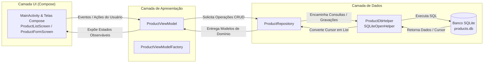

# Utilização do Jetpack Compose com Arquitetura MVVM e SQLite

> **Projeto Android Nativo** desenvolvido em Kotlin demonstrando boas práticas de engenharia de software com **Jetpack Compose**, separação de responsabilidades com padrão **MVVM (Model-View-ViewModel)**, padrão **Repository** e persistência local via **SQLite (`SQLiteOpenHelper`)**.

---

## 📑 Sumário

- [Visão Geral](#-visão-geral)
- [Arquitetura e Fluxo de Dados](#-arquitetura-e-fluxo-de-dados)
- [O que é Jetpack Compose?](#-o-que-é-jetpack-compose)
- [Configuração do Ambiente e Dependências](#-configuração-do-ambiente-e-dependências)
  - [Version Catalog (libs.versions.toml)](#version-catalog-gradlelibsversionstoml)
  - [Módulo app (build.gradle.kts)](#módulo-app-appbuildgradlekts)
  - [Entendendo as Dependências e Plugins](#entendendo-as-dependências-e-plugins)
- [Estrutura do Projeto](#-estrutura-do-projeto)
  - [Papel de Cada Componente](#papel-de-cada-componente)
- [Funcionalidades do Aplicativo](#-funcionalidades-do-aplicativo)
- [Como Executar o Projeto](#-como-executar-o-projeto)

---

## 🎯 Visão Geral

O objetivo principal deste projeto é ilustrar de maneira clara e didática a separação de responsabilidades em um aplicativo Android moderno. Em vez de centralizar regras de negócio, chamadas ao banco e interface gráfica na `MainActivity`, o projeto divide as responsabilidades em camadas bem delimitadas:

- **Interface Visual (UI / View):** Desenvolvida declarativamente com **Jetpack Compose** e **Material 3**. Observa estados emitidos pelo ViewModel e reage a eventos do usuário.
- **Camada de Apresentação e Estado (ViewModel):** Retém os estados da UI (`products`, `searchQuery`, `editingProduct`, `currentScreen`), sobrevive a recomposições e coordena as intenções de usuário.
- **Camada de Repositório (Repository):** Abstrai as operações de dados. O ViewModel interage exclusivamente com o repositório, desacoplando a lógica de tela dos detalhes de implementação do SQLite.
- **Camada de Dados Local (Data Source / SQLite):** Gerenciada por `ProductDbHelper` que estende `SQLiteOpenHelper`, executando queries SQL nativas (CRUD).

---

## 🏛️ Arquitetura e Fluxo de Dados

Abaixo está o fluxo unidirecional de dados (Unidirectional Data Flow - UDF) implementado:



### Principais Benefícios:
1. **Desacoplamento:** A tela não sabe que existe um banco SQLite rodando por baixo. Caso queira migrar futuramente para Room Database ou uma API REST, basta ajustar o repositório sem quebrar a interface gráfica.
2. **Testabilidade:** Repositórios e ViewModels podem ser testados de forma independente de componentes de interface ou ciclo de vida de Activities.
3. **Manutenibilidade:** Código legível, com responsabilidades claras para cada arquivo.

---

## 🎨 O que é Jetpack Compose?

O **Jetpack Compose** é o kit de ferramentas moderno e declarativo do Android para criação de interfaces de usuário em Kotlin puro:

- **Substituição do XML:** Em vez de arquivos de layout XML (`activity_main.xml`), estilos e seletores, toda a interface é definida no código Kotlin usando funções anotadas com `@Composable`.
- **Paradigma Declarativo:** Descreve-se a UI em termos de seu estado atual. Quando o estado muda (por exemplo, ao digitar no campo de busca ou excluir um produto), o Compose automaticamente recalcula e redesenha apenas os componentes que dependem desse estado (*recomposição*).
- **Material Design 3:** Integração nativa com os componentes modernos de design (`Scaffold`, `TopAppBar`, `Card`, `OutlinedTextField`, `Button`).

---

## ⚙️ Configuração do Ambiente e Dependências

O projeto utiliza o **Gradle Version Catalogs** (`libs.versions.toml`) e scripts de build em Kotlin DSL (`build.gradle.kts`).

### Version Catalog (`gradle/libs.versions.toml`)

Contém as versões e aliases das bibliotecas utilizadas:

```toml
[versions]
agp = "9.1.0"
coreKtx = "1.15.0"
appcompat = "1.7.0"
material = "1.12.0"
activityCompose = "1.9.3"
composeBom = "2024.10.01"
lifecycleViewmodelCompose = "2.8.7"
kotlin = "2.1.10"

[libraries]
androidx-core-ktx = { group = "androidx.core", name = "core-ktx", version.ref = "coreKtx" }
androidx-appcompat = { group = "androidx.appcompat", name = "appcompat", version.ref = "appcompat" }
material = { group = "com.google.android.material", name = "material", version.ref = "material" }
androidx-activity-compose = { group = "androidx.activity", name = "activity-compose", version.ref = "activityCompose" }
androidx-compose-bom = { group = "androidx.compose", name = "compose-bom", version.ref = "composeBom" }
androidx-compose-ui = { group = "androidx.compose.ui", name = "ui" }
androidx-compose-ui-graphics = { group = "androidx.compose.ui", name = "ui-graphics" }
androidx-compose-ui-tooling-preview = { group = "androidx.compose.ui", name = "ui-tooling-preview" }
androidx-compose-material3 = { group = "androidx.compose.material3", name = "material3" }
androidx-lifecycle-viewmodel-compose = { group = "androidx.lifecycle", name = "lifecycle-viewmodel-compose", version.ref = "lifecycleViewmodelCompose" }

[plugins]
android-application = { id = "com.android.application", version.ref = "agp" }
kotlin-compose = { id = "org.jetbrains.kotlin.plugin.compose", version.ref = "kotlin" }
```

### Módulo app (`app/build.gradle.kts`)

> [!IMPORTANT]
> Certifique-se de editar o arquivo `build.gradle.kts` correspondente ao **Module :app** e habilitar `buildFeatures { compose = true }`.

```kotlin
plugins {
    alias(libs.plugins.android.application)
    alias(libs.plugins.kotlin.compose)
}

android {
    namespace = "com.example.produtossqlite"
    compileSdk = 35

    defaultConfig {
        applicationId = "com.example.produtossqlite"
        minSdk = 24
        targetSdk = 35
        versionCode = 1
        versionName = "1.0"

        testInstrumentationRunner = "androidx.test.runner.AndroidJUnitRunner"
    }

    compileOptions {
        sourceCompatibility = JavaVersion.VERSION_11
        targetCompatibility = JavaVersion.VERSION_11
    }

    buildFeatures {
        compose = true
    }
}

dependencies {
    implementation(libs.androidx.core.ktx)
    implementation(libs.androidx.appcompat)
    implementation(libs.material)
    implementation(libs.androidx.activity.compose)
    implementation(platform(libs.androidx.compose.bom))
    implementation(libs.androidx.compose.ui)
    implementation(libs.androidx.compose.ui.graphics)
    implementation(libs.androidx.compose.ui.tooling.preview)
    implementation(libs.androidx.compose.material3)
    implementation(libs.androidx.lifecycle-viewmodel-compose)
}
```

### Entendendo as Dependências e Plugins

| Dependência / Plugin | Função / Propósito |
| :--- | :--- |
| `com.android.application` | Plugin oficial que configura o módulo para compilar um APK/Bundle Android. |
| `org.jetbrains.kotlin.plugin.compose` | Plugin do compilador Kotlin que viabiliza transformações necessárias para o Jetpack Compose. |
| `buildFeatures { compose = true }` | Ativa o suporte a Compose dentro do Android Gradle Plugin (AGP). |
| `compose-bom` (Bill of Materials) | Centraliza o alinhamento de versões das bibliotecas do Jetpack Compose, evitando conflitos de compatibilidade. |
| `activity-compose` | Permite ligar o Compose ao ciclo de vida da Activity através do método `setContent { }`. |
| `material3` | Conjunto completo de componentes visuais seguindo o padrão Google Material Design 3. |
| `lifecycle-viewmodel-compose` | Disponibiliza a função `viewModel()`, permitindo instanciar e recuperar ViewModels diretamente em Composable functions. |
| `ui-tooling-preview` | Suporte para renderização em tempo real de telas anotadas com `@Preview` no Android Studio. |

---

## 📂 Estrutura do Projeto

Abaixo está o mapa de diretórios e arquivos com as responsabilidades detalhadas:

```text
app/
├── build.gradle.kts
└── src/
    └── main/
        ├── AndroidManifest.xml
        └── java/com/example/produtossqlite/
            ├── MainActivity.kt
            ├── model/
            │   └── Product.kt
            ├── data/
            │   ├── local/
            │   │   └── ProductDbHelper.kt
            │   └── repository/
            │       └── ProductRepository.kt
            ├── viewmodel/
            │   ├── ProductViewModel.kt
            │   └── ProductViewModelFactory.kt
            └── ui/
                ├── components/
                │   └── ProductItem.kt
                └── screens/
                    ├── ProductListScreen.kt
                    └── ProductFormScreen.kt
```

### Papel de Cada Componente

#### 1. Camada de Modelo (`model`)
- **[Product.kt](/app/src/main/java/com/example/produtossqlite/model/Product.kt):**  
  `data class Product(id, name, price, quantity)`. Representa o modelo de domínio do produto manipulado na interface e persistido no SQLite.

#### 2. Camada de Dados (`data`)
- **[ProductDbHelper.kt](/app/src/main/java/com/example/produtossqlite/data/local/ProductDbHelper.kt):**  
  Subclasse de `SQLiteOpenHelper`. Gerencia a criação da tabela `products` no banco `products.db` e implementa as rotinas de `insertProduct()`, `getAllProducts()`, `updateProduct()` e `deleteProduct()`.
- **[ProductRepository.kt](/app/src/main/java/com/example/produtossqlite/data/repository/ProductRepository.kt):**  
  Padrão Repository. Intermedeia as chamadas entre o ViewModel e o `ProductDbHelper`, isolando a fonte de dados do restante da aplicação.

#### 3. Camada de Apresentação (`viewmodel`)
- **[ProductViewModel.kt](/app/src/main/java/com/example/produtossqlite/viewmodel/ProductViewModel.kt):**  
  Responsável por expor estados como `products`, `searchQuery`, `editingProduct` e `currentScreen` usando `mutableStateOf`. Fornece ações para pesquisa em tempo real (`filteredProducts`), abertura de formulários, salvamento e remoção de itens.
- **[ProductViewModelFactory.kt](/app/src/main/java/com/example/produtossqlite/viewmodel/ProductViewModelFactory.kt):**  
  Implementação de `ViewModelProvider.Factory`. Permite instanciar o `ProductViewModel` injetando uma instância de `ProductRepository`.

#### 4. Interface com o Usuário (`ui`)
- **[MainActivity.kt](/app/src/main/java/com/example/produtossqlite/MainActivity.kt):**  
  Ponto de entrada do app. Inicializa o banco de dados, repositório e factory, configurando o `setContent { }` com `ProductApp` para alternar entre listagem e formulário.
- **[ProductListScreen.kt](/app/src/main/java/com/example/produtossqlite/ui/screens/ProductListScreen.kt):**  
  Tela principal de listagem. Exibe campo de busca dinâmico, botão para adicionar novo produto e lista de itens em `LazyColumn`.
- **[ProductFormScreen.kt](/app/src/main/java/com/example/produtossqlite/ui/screens/ProductFormScreen.kt):**  
  Tela de cadastro/edição. Contém campos de texto (`OutlinedTextField`), validações numéricas e diálogo de alerta (`AlertDialog`) para entradas inválidas.
- **[ProductItem.kt](/app/src/main/java/com/example/produtossqlite/ui/components/ProductItem.kt):**  
  Componente `Card` reutilizável que exibe nome, preço formatado em moeda brasileira (BRL / `R$`) e quantidade, além dos botões de ação (Editar e Excluir).

---

## 📱 Funcionalidades do Aplicativo

- [x] **Cadastro de Produtos:** Registro de nome, valor monetário e quantidade em estoque com validação.
- [x] **Listagem com Rolagem Otimizada:** Exibição eficiente de itens via `LazyColumn`.
- [x] **Pesquisa em Tempo Real:** Filtragem instantânea da lista conforme o usuário digita no campo de busca.
- [x] **Edição de Registros:** Pré-preenchimento dos dados existentes no formulário e atualização no banco.
- [x] **Exclusão de Produtos:** Remoção direta com atualização imediata da listagem.
- [x] **Formatação de Moeda:** Exibição amigável dos preços em Real (`R$`) com `NumberFormat`.
- [x] **Tratamento de Entradas:** Alertas amigáveis quando campos obrigatórios ou formatos numéricos estiverem incorretos.

---

## 🚀 Como Executar o Projeto

1. Abra o **Android Studio** (versão Ladybug / Hedgehog ou superior recomendada).
2. Selecione a opção **Open** e aponte para a pasta raiz do projeto (`produtos-sql-lite`).
3. Aguarde o término da sincronização do Gradle (**Gradle Sync**).
4. Conecte um dispositivo físico com depuração USB ativada ou inicie um Emulador Android (AVD) com Android 7.0 (API 24) ou superior.
5. Clique em **Run 'app'** (`Shift + F10`) no Android Studio para compilar e instalar o app.